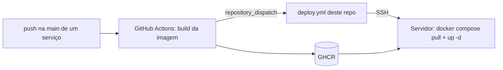

# Money Track · infra

Configuração de deploy do [Money Track](https://github.com/matheus-santos-da-silva/money-track): um Docker Compose com toda a stack e o Caddy como proxy reverso com HTTPS automático, mais o workflow do GitHub Actions que atualiza o servidor.

## O que tem aqui

| Arquivo | Papel |
|---|---|
| `docker-compose.prod.yml` | Kafka (KRaft, sem Zookeeper), dois PostgreSQL 16, users-service, finance-service e Caddy |
| `Caddyfile` | Roteia `/users/*` e `/finance/*` para cada serviço, com certificado Let's Encrypt emitido e renovado sozinho e cabeçalhos de segurança |
| `.github/workflows/deploy.yml` | Conecta por SSH no servidor, atualiza este repositório, baixa as imagens novas e reinicia os containers |

## Pipeline



1. Um push na `main` do [users-service](https://github.com/matheus-santos-da-silva/money-track-user-service) ou do [finance-service](https://github.com/matheus-santos-da-silva/money-track-finance-service) gera a imagem e a publica no GHCR (`latest` e o SHA do commit).
2. Se a variável `DEPLOY_ENABLED` estiver ativa no repositório do serviço, ele dispara um `repository_dispatch` para cá.
3. O workflow deste repositório faz o `docker compose pull` e o `up -d` no servidor. Cada serviço aplica as migrations (`prisma migrate deploy`) ao iniciar.

## Subindo num servidor

Pré-requisitos: Docker com Compose e as portas 80 e 443 abertas.

1. Clone este repositório no servidor.
2. Crie `users-service/.env.production` e `finance-service/.env.production` com as credenciais dos bancos, `JWT_SECRET` (o mesmo nos dois) e as variáveis da Google Play. Nunca os commite.
3. Ajuste o domínio no `Caddyfile` e aponte o DNS para o servidor.
4. Suba a stack e, só na primeira vez, rode o seed das categorias padrão:

```bash
export USERS_SERVICE_IMAGE=ghcr.io/<usuario>/users-service:latest
export FINANCE_SERVICE_IMAGE=ghcr.io/<usuario>/finance-service:latest
docker compose -f docker-compose.prod.yml up -d
docker compose -f docker-compose.prod.yml exec finance-service yarn run seed:prod
```

Secrets usados pelo workflow: `VPS_HOST`, `VPS_USER`, `VPS_SSH_KEY` e `GHCR_TOKEN` neste repositório; `DEPLOY_TOKEN` nos repositórios dos serviços.
